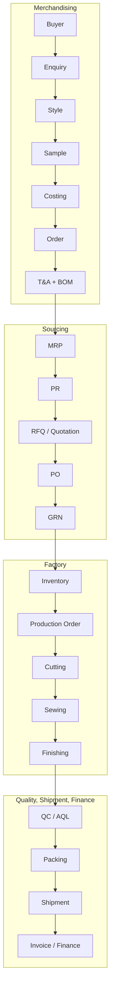
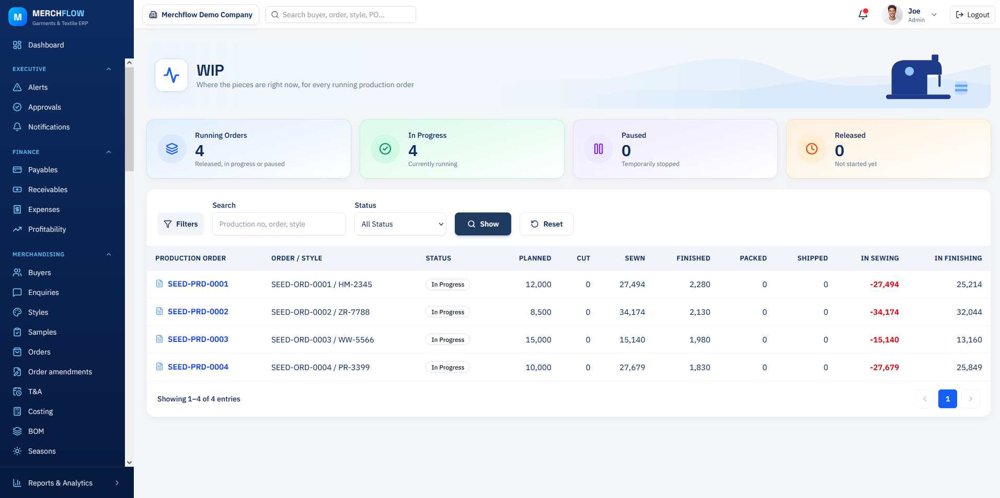
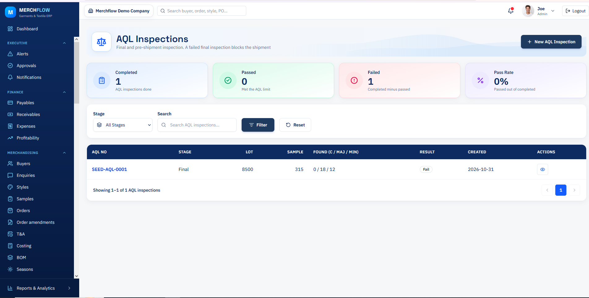
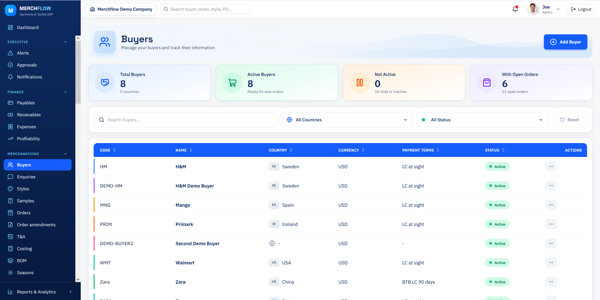
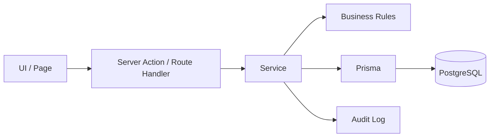

<div align="center">

# 🧵 MERCHFLOW

**Garments & Textile ERP for modern export factories**

Buyer enquiry theke shipment ar invoice porjonto, shob kichu ekta connected system-e.

<br>


**One order → one connected operational truth**

[Parichoy](#-parichoy) • [Features](#-key-features) • [Modules](#-modules) • [Tech Stack](#-tech-stack) • [Quick Start](#-quick-start) • [Docs](#-documentation)

<br>


</div>

---

## 📋 Table of Contents

1. [Parichoy](#-parichoy)
2. [MERCHFLOW ki proshner uttor dey](#-merchflow-ki-proshner-uttor-dey)
3. [Business Flow](#-business-flow)
4. [Key Features](#-key-features)
5. [Modules](#-modules)
6. [Tech Stack](#-tech-stack)
7. [Architecture](#-architecture)
8. [Security](#-security)
9. [Quick Start](#-quick-start)
10. [Demo Data](#-demo-data)
11. [Development Commands](#-development-commands)
12. [Folder Structure](#-folder-structure)
13. [Documentation](#-documentation)
14. [Roadmap](#-roadmap)
15. [Contributing](#-contributing)
16. [License](#-license)

---

## 🚀 Parichoy

MERCHFLOW ekta garments ar textile manufacturing ERP, Bangladesh-er RMG / export-oriented / composite factory-r jonno banano.

Eta alada alada CRUD page-er collection na. Prottek record Company, Factory, Buyer, Order, Style, Color, Size, Material, Supplier-er sathe connected thake. Ekbar data dile (buyer, style, order qty, BOM) porer step gulo oi data reuse kore, abar type korte hoy na.

| | |
|---|---|
| **Industry** | Garments / Apparel / Textile |
| **Target** | Bangladesh RMG, export factory, composite factory |
| **Scope** | Multi-company, multi-factory, multi-line |
| **Core principle** | One order → one connected operational truth |
| **Language** | English + Bangla |

---

## 🎯 MERCHFLOW ki proshner uttor dey

- Kon buyer-er kon order ekhon cholche?
- Kon style shipment miss korar jhunkite ache?
- Kon sample buyer approval-er opekkhay?
- Fabric koto lagbe, koto book hoyeche, koto ashche, koto ache?
- Kon supplier late?
- Kon production order-e material short?
- Kon line overloaded? Aj cutting / sewing / finishing output koto?
- Line efficiency koto? Kon defect barche?
- Order-er koto ongsho pack hoyeche, shipment balance koto?
- Kon order ar kon buyer profitable?
- Kono material, PO ba shipment-er exact history ki?

---

## 🔄 Business Flow



### Design principles

| Principle | Mane |
|---|---|
| **Order-centric** | Central object holo Order. Downstream record order/style-er sathe traceable |
| **No duplicate entry** | Order qty → MRP, BOM → procurement, GRN → inventory, output → WIP, packing → finished goods |
| **Configuration over hard-coding** | Approval rule, T&A template, production route, buyer config configurable |
| **Full audit** | Actor, time, before/after, reason record hoy |
| **Exception-first** | Delay, shortage, late supplier, failed inspection dashboard-e uthe ashe |
| **Server-side security** | Permission check server-e, frontend-er upor nirbhor na |

---

## ✨ Key Features

### 📊 Exception-first Dashboard

Manager-ke prottek record kholte hoy na. Dashboard-e dekhay: order status, order progress, shipment risk, material shortage, material exposure, production vs target, alerts, top buyers, upcoming shipment ar T&A, receivables.

`/dashboard` • `/alerts` • `/analytics`


### 🗓️ Order & T&A

Order matrix (color × size), amendment history, T&A milestone, calendar ar delay risk. T&A delay hole shipment-risk alert uthe.

`/orders` • `/tna` • `/tna/calendar` • `/tna/risk` • `/tna/templates`


### 💰 Costing & BOM

Versioned costing sheet, margin ar price calculation, Pre costing ar Post costing (estimate vs actual variance). Approved costing bodlano jay na, notun version lage. Multi-currency: transaction currency, base currency, exchange rate ar rate date save hoy.

`/costing` • `/bom` • `/currency`


### 🛒 Procurement

BOM theke MRP, tarpor PR → RFQ / Quotation → PO → GRN. Supplier follow-up, late delivery, proforma invoice.

`/material-requirements` • `/prs` • `/rfqs` • `/quotations` • `/purchase-orders` • `/goods-receipts` • `/follow-ups`


### 🏭 Production Floor

PPC ar capacity, production order, cutting (bundle), hourly sewing log (target, output, reject, rework, downtime), finishing, WIP, subcontract.

`/ppc` • `/production-orders` • `/cutting` • `/sewing` • `/finishing` • `/wip` • `/subcontract`



### ✅ Quality

Inspection, AQL / final inspection, defect library, DHU, CAPA. Final inspection fail hole alert uthe.

`/quality/inspections` • `/quality/aql` • `/quality/defects` • `/quality/dhu` • `/quality/capa`



### 🌐 Buyer & Supplier Portal

Buyer: style, sample status, approval, order, T&A, shipment. Supplier: RFQ, PO, confirm, shipment update, document, invoice. Dui portal alada, supplier factory-r internal data dekhe na.

`/portal/buyer` • `/portal/supplier`



### 🔐 Security, Approval & Audit

Role + Permission + Scope, MFA (authenticator + backup code), approval engine, audit log.

`/admin/users` • `/admin/roles` • `/approvals` • `/admin/audit-logs` • `/account/security`

---

## 🧩 Modules

<details>
<summary><b>🏛️ Core Platform</b></summary>

| Module | Route |
|---|---|
| Login, forgot / reset password | `/login`, `/forgot-password`, `/reset-password` |
| Profile, MFA | `/account/profile`, `/account/security` |
| Users, Roles, Portal users | `/admin/users`, `/admin/roles`, `/admin/portal-users` |
| Audit log | `/admin/audit-logs` |
| Approval engine + rules | `/approvals`, `/approvals/rules` |
| Notifications, Alerts | `/notifications`, `/alerts` |
| Documents, Import | `/documents`, `/import` |
| Jobs, Scheduled reports | `/admin/jobs`, `/admin/scheduled-reports` |
| Organization, Warehouses, Currency | `/organization`, `/warehouses`, `/currency` |
| QR / barcode scan | `/scan` |

</details>

<details>
<summary><b>🤝 Commercial & Merchandising</b></summary>

| Module | Route |
|---|---|
| Buyers | `/buyers` |
| Enquiries | `/enquiries` |
| Seasons | `/seasons` |
| Styles | `/styles` |
| Samples + calendar | `/samples`, `/samples/calendar` |
| Quotations | `/quotations` |
| Orders + amendments | `/orders`, `/orders/amendments` |
| T&A | `/tna`, `/tna/calendar`, `/tna/risk`, `/tna/templates` |
| Costing | `/costing` |
| BOM | `/bom` |

</details>

<details>
<summary><b>📦 Sourcing & Inventory</b></summary>

| Module | Route |
|---|---|
| Material requirements (MRP) | `/material-requirements` |
| Purchase requisition | `/prs` |
| RFQ | `/rfqs` |
| Purchase order + proforma invoice | `/purchase-orders`, `/purchase-orders/proforma-invoices` |
| Suppliers | `/suppliers` |
| Supplier follow-up | `/follow-ups` |
| GRN | `/goods-receipts` |
| Inventory, lots, rolls, adjustments, transfers | `/inventory/*` |
| Fabric rolls | `/fabric-rolls` |
| Material issue / return | `/material-issues`, `/material-returns` |

</details>

<details>
<summary><b>🧶 Textile Processing</b></summary>

| Module | Route |
|---|---|
| Yarn | `/textile/yarn` |
| Knitting | `/textile/knitting` |
| Dyeing | `/textile/dyeing` |
| Fabric finishing | `/textile/finishing` |
| Lab dip | `/textile/lab-dips` |

</details>

<details>
<summary><b>🏭 Production</b></summary>

| Module | Route |
|---|---|
| PPC + capacity | `/ppc`, `/ppc/capacity` |
| Production order + routes | `/production-orders`, `/production-orders/routes` |
| Cutting + bundles | `/cutting`, `/cutting/bundles/[id]` |
| Sewing | `/sewing` |
| Finishing | `/finishing` |
| WIP | `/wip` |
| Industrial engineering | `/ie` |
| Subcontract | `/subcontract` |

</details>

<details>
<summary><b>✅ Quality</b></summary>

| Module | Route |
|---|---|
| Inspections | `/quality/inspections` |
| AQL | `/quality/aql` |
| CAPA | `/quality/capa` |
| Defects | `/quality/defects` |
| DHU | `/quality/dhu` |

</details>

<details>
<summary><b>🚢 Packing, Shipment & Commercial</b></summary>

| Module | Route |
|---|---|
| Cartons | `/packing/cartons` |
| Shipments | `/shipments` |
| Forwarders | `/shipments/forwarders` |
| Export documents | `/commercial/documents` |

</details>

<details>
<summary><b>💼 Finance</b></summary>

| Module | Route |
|---|---|
| Payables | `/finance/payables` |
| Receivables | `/finance/receivables` |
| Expenses | `/finance/expenses` |
| Profitability | `/finance/profitability` |

</details>

<details>
<summary><b>📈 Management & Intelligence</b></summary>

| Module | Route |
|---|---|
| Dashboard | `/dashboard` |
| Analytics + export / print | `/analytics` |
| AI insights | `/ai` |

</details>

<details>
<summary><b>🔌 API</b></summary>

| Endpoint | Kaj |
|---|---|
| `/api/health` | Health check |
| `/api/jobs/run` | Background job trigger |
| `/api/avatar/[id]` | User avatar |
| `/api/auth/[...nextauth]` | Authentication |
| `/api/v1/portal/buyer/*` | Buyer portal API |
| `/api/v1/portal/supplier/*` | Supplier portal API |

</details>

---

## 🧱 Tech Stack

| Layer | Library / tool | Kaj |
|---|---|---|
| Framework | Next.js 16 (App Router, Turbopack), React 19, TypeScript 5 | App, server action, route handler |
| Styling | Tailwind CSS v4 + `@tailwindcss/postcss` | Token `src/app/globals.css`-er `@theme`-e, `tailwind.config` nai |
| UI helpers | `class-variance-authority`, `clsx`, `tailwind-merge`, `lucide-react` | shadcn-style component, class merge, icon |
| Forms & validation | `react-hook-form`, `@hookform/resolvers`, `zod` 4 | Form, schema validation |
| Table | `@tanstack/react-table` | Data table |
| Database | PostgreSQL (Supabase) | Main database |
| ORM | Prisma 7 (`prisma`, `@prisma/client`) + `@prisma/adapter-pg` + `pg` | Query; client `src/generated/prisma`-te generated (edit korbe na) |
| Auth | `next-auth` v5 (beta) | Login session |
| Security | `bcryptjs`, TOTP MFA + backup code (`src/lib/totp.ts`) | Password hash, two-factor |
| QR code | `qrcode` | QR code generate |
| Excel | `exceljs` | Excel file toiri / porha |
| 3D | `three` 0.187, `@react-three/fiber`, `@types/three` | 3D graphics. [FILL] kon page-e ar ki dekhate use hoy |
| Charts | Hand-made SVG / CSS | Recharts nai |
| Env | `dotenv` | `.env` load (script-e) |
| Test | Vitest 5 | `npm test` |
| Lint / type | ESLint 9 + `eslint-config-next`, TypeScript | Code check |
| Script runner | `tsx` | `npx tsx scripts/...`, seed |
| Language | English + Bangla | `src/messages/en.ts`, `bn.ts` |

---

## 🏗️ Architecture



- Business logic UI component-e na, `src/services/*.service.ts`-e.
- Service gulo `BaseService` extend kore. Prottek method:
  1. `this.guard("permission.key")` diye permission check
  2. `listFilter(user)` diye company / factory scope
  3. rule check (`src/lib/business-rules.ts`, `status-rules.ts`)
  4. kaj korar por `this.audit(...)`
- Server action gulo `runAction` (`src/lib/action-result.ts`) diye wrap kora.
- Status change `assertTransition` diye, jekhane khushi status bodlano jay na.
- Money: transaction currency, base currency, exchange rate, rate date save hoy. Purano transaction aj-er rate diye abar hisab hoy na.

<details>
<summary><b>🔁 Status flow</b></summary>

| Entity | Flow |
|---|---|
| Order | Draft → Confirmed → In Production → Partially Shipped → Fully Shipped → Closed |
| Sample | Requested → In Development → Internal QC → Sent → Buyer Review → Approved / Rejected → Revision |
| PR | Draft → Submitted → Approved → PO Created → Closed |
| PO | Draft → Submitted → Approved → Sent → Acknowledged → Partial Receipt → Complete → Closed |
| Production | Planned → Released → In Progress → Paused → Completed → Closed |
| Shipment | Draft → Planned → Documents Ready → Booked → Shipped → Delivered → Closed |

</details>

<details>
<summary><b>📏 Coding rules (ESLint / React Compiler)</b></summary>

- Render-er bhitore component toiri korbe na (module-level map ba `createElement` use koro).
- Render-er bhitore variable reassign korbe na (`reduce` / `filter` use koro).
- `useEffect`-er bhitore synchronous `setState` korbe na.
- `watch()` er bodole `useWatch` use koro.

</details>

---

## 🔒 Security

- ✅ Role + Permission + Scope (Company / Factory)
- ✅ Server-side permission check
- ✅ Optional MFA: authenticator code + backup code, replay protection
- ✅ Audit log
- ✅ Buyer ar supplier portal alada boundary-te
- ✅ Password hash (`bcryptjs`)

---

## ⚡ Quick Start

Requirement: Node.js, PostgreSQL database (Supabase), PowerShell / VS Code.

### Step 1: Clone

```powershell
git clone https://github.com/naeemislamofficiall-dev/merchflow-app.git
cd merchflow-app
# [FILL] project jodi nested folder-e thake (amar machine-e merchflow-app\merchflow) tahole: cd merchflow
```

### Step 2: Install

```powershell
npm install
```

### Step 3: `.env` toiri koro

Secret kokhono git-e commit korbe na.

```
DATABASE_URL="postgresql://..."
# [FILL] baki variable (auth secret etc.) .env theke dekhe likho
```

### Step 4: Prisma client generate

```powershell
npx prisma generate
```

### Step 5: Setup script

`scripts/` folder-e `create-admin.ts`, `seed-permissions.ts`, `seed-currency.ts`, `seed-rate.ts` ache.

```powershell
npx tsx scripts/<file>.ts
```

[FILL] prothom setup-er sothik order ekhane likho.

### Step 6: Run

```powershell
npm run dev
```

App: http://localhost:3000

<details>
<summary><b>🗄️ Database kaj korar niyom</b></summary>

- Schema change hole SQL Supabase SQL editor-e chalao, tarpor:
  ```powershell
  npx prisma db pull
  npx prisma generate
  npm run typecheck
  ```
- **`prisma migrate dev` chalabe na.**
- `Property 'userMfa' does not exist` error mane table DB-te nai. `sql/user-mfa.sql` chalao.
- `.next/types/validator.ts ... Cannot find module` error mane purono build cache:
  ```powershell
  Remove-Item -Recurse -Force .next
  ```

</details>

---

## 🌱 Demo Data

```powershell
npx tsx prisma/seed-demo.ts           # demo data bosao
npx tsx prisma/seed-demo.ts --reset   # sheta muche abar bosao
```

Eta shudhu `SEED-` diye shuru hoya record chhuye. Master data (buyer, style, supplier, material) upsert hoy, delete hoy na. Tarpor `/dashboard` kholo.

---

## 🛠️ Development Commands

| Command | Kaj |
|---|---|
| `npm run dev` | Dev server |
| `npm run build` | Production build |
| `npm run lint` | ESLint |
| `npm run typecheck` | Type check (`tsc --noEmit`) |
| `npm test` | Unit test (Vitest) |
| `npm run check:structure` | Project structure check |

Prottek change-er por chalao: `npm run typecheck` ar `npm run lint` (0 error), tarpor `npm run build`.

---

## 📁 Folder Structure

```
src/
├── app/(app)/<module>/page.tsx      server page; client part alada file-e
├── app/(app)/<module>/actions.ts    server actions (runAction diye wrapped)
├── app/api/                         route handlers
├── services/*.service.ts            business logic (BaseService extend kore)
├── lib/                             rules, calculations, helpers, tests
├── components/ui                    shadcn-style base components
├── components/{layout,dashboard,approvals,detail,forms}
├── messages/                        en.ts, bn.ts
└── generated/prisma/                Prisma client (generated)
prisma/                              schema + seed
scripts/                             admin / setup script
sql/                                 manual SQL (Supabase SQL editor-e chalate hoy)
docs/                                documentation, images, archive
public/  storage/                    static file, uploaded avatar
```

---

## 📚 Documentation

- `docs/backup-and-recovery.md`, `docs/golden-demo.md` ([FILL] gulo bharte hobe)
- `docs/archive/` purano patch note ar SQL, ekhon ar lage na
- Master spec: `MERCHFLOW_Enterprise_Garments_ERP_Master_Specification.docx`

---

## 🗺️ Roadmap

Ei page gulo spec-e ache kintu ekhon build-er route list-e nai:

- [ ] HR: `/employees`, `/attendance`, `/leave`, `/payroll`
- [ ] Stock transfer / stock count alada page, `/suppliers/performance`, `/ie/*` alada sub-page
- [ ] Offline / poor network support (spec-e Phase 2)
- [ ] Golden demo scenario (Buyer → Order → ... → Shipment) full end-to-end test

---

## 🤝 Contributing

Commit message style:

```
feat: add buyer order management
fix: prevent shipment over-allocation
test: add mrp calculation tests
```

Notun change-er age `npm run typecheck`, `npm run lint`, `npm test` chalao.

---

## 📄 License

[FILL] License likho (MIT / Private / Proprietary).

---

<div align="center">

Made with ❤️ by [Naeem Islam]

[⬆ Back to Top](#-table-of-contents)

</div>