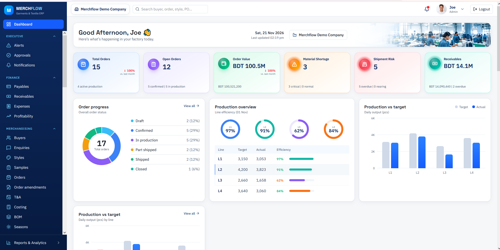
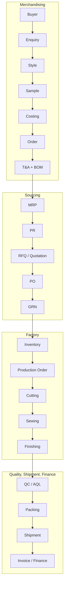
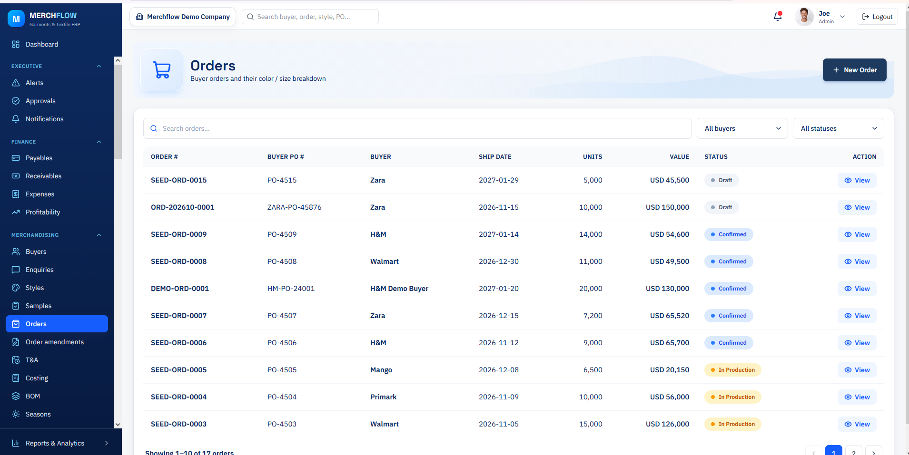
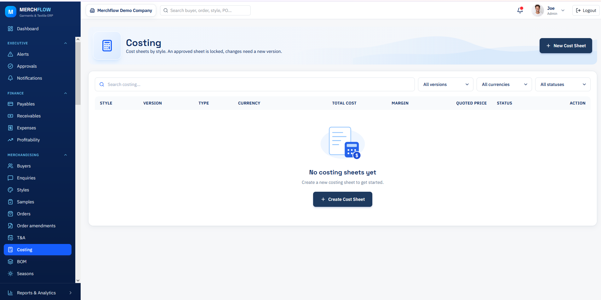
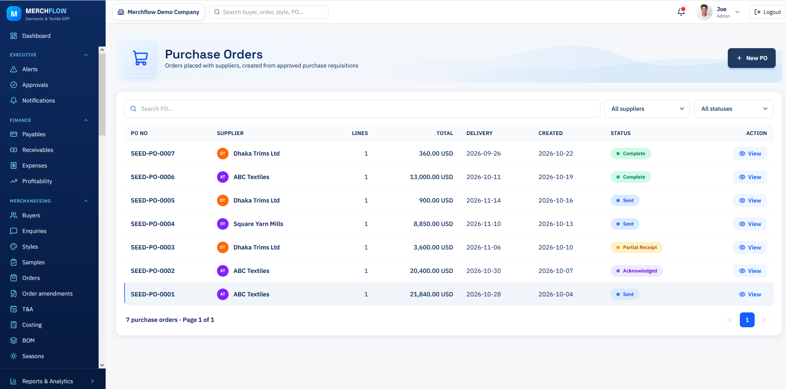
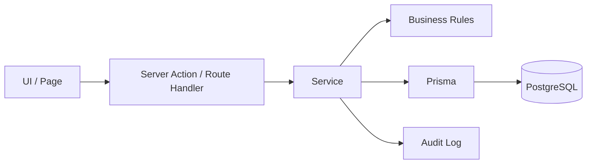

<div align="center">

# 🧵 MERCHFLOW

**Garments & Textile ERP for modern export factories**

From buyer enquiry to shipment and invoice, everything in one connected system.

<br>


**One order → one connected operational truth**

[Introduction](#-introduction) • [Features](#-key-features) • [Modules](#-modules) • [Tech Stack](#-tech-stack) • [Quick Start](#-quick-start) • [Docs](#-documentation)

<br>



</div>

---

## 📋 Table of Contents

1. [Introduction](#-introduction)
2. [Questions MERCHFLOW Answers](#-questions-merchflow-answers)
3. [Business Flow](#-business-flow)
4. [Key Features](#-key-features)
5. [Modules](#-modules)
6. [Tech Stack](#-tech-stack)
7. [Architecture](#-architecture)
8. [Security](#-security)
9. [Quick Start](#-quick-start)
10. [Demo Data](#-demo-data)
11. [Development Commands](#-development-commands)
12. [Folder Structure](#-folder-structure)
13. [Documentation](#-documentation)
14. [Roadmap](#-roadmap)
15. [Contributing](#-contributing)
16. [License](#-license)

---

## 🚀 Introduction

MERCHFLOW is an ERP for garments and textile manufacturing, built for Bangladeshi RMG, export-oriented and composite factories.

It is not a collection of separate CRUD pages. Every record is connected to the Company, Factory, Buyer, Order, Style, Color, Size, Material and Supplier it belongs to. Data is entered once (buyer, style, order quantity, BOM) and every later step reuses it, so nothing has to be typed twice.

| | |
|---|---|
| **Industry** | Garments / Apparel / Textile |
| **Target** | Bangladeshi RMG, export-oriented and composite factories |
| **Scope** | Multi-company, multi-factory, multi-line |
| **Core principle** | One order → one connected operational truth |
| **Languages** | English and Bangla |

---

## 🎯 Questions MERCHFLOW Answers

- Which buyer's order is running right now?
- Which styles are at risk of missing their shipment date?
- Which samples are waiting for buyer approval?
- How much fabric is required, booked, on the way and in stock?
- Which suppliers are late?
- Which production orders are short of material?
- Which lines are overloaded? What was today's cutting, sewing and finishing output?
- What is the line efficiency? Which defects are increasing?
- How much of an order is packed, and what is the remaining shipment balance?
- Which orders and buyers are profitable?
- What is the exact history of a material, a PO or a shipment?

---

## 🔄 Business Flow



### Design principles

| Principle | Meaning |
|---|---|
| **Order-centric** | The Order is the central object. Every downstream record stays traceable to its order and style |
| **No duplicate entry** | Order quantity → MRP, BOM → procurement, GRN → inventory, output → WIP, packing → finished goods |
| **Configuration over hard-coding** | Approval rules, T&A templates, production routes and buyer settings are configurable |
| **Full audit** | Actor, time, before/after values and reason are recorded |
| **Exception-first** | Delays, shortages, late suppliers and failed inspections surface on the dashboard |
| **Server-side security** | Permissions are enforced on the server, never trusting the frontend |

---

## ✨ Key Features

### 📊 Exception-first Dashboard

Managers do not have to open every record. The dashboard shows order status, order progress, shipment risk, material shortage, material exposure, production vs target, alerts, top buyers, upcoming shipments and T&A milestones, and receivables.

`/dashboard` • `/alerts` • `/analytics`


### 🗓️ Orders & T&A

Order matrix (color × size), amendment history, T&A milestones, calendar and delay risk. A delayed T&A milestone raises a shipment-risk alert.

`/orders` • `/tna` • `/tna/calendar` • `/tna/risk` • `/tna/templates`



### 💰 Costing & BOM

Versioned cost sheets with margin and price calculation, pre-costing and post-costing (estimate vs actual variance). An approved cost sheet cannot be edited; a new version is required. Multi-currency: the transaction currency, base currency, exchange rate and rate date are stored with each record.

`/costing` • `/bom` • `/currency`



### 🛒 Procurement

MRP from the BOM, then PR → RFQ / Quotation → PO → GRN. Includes supplier follow-up, late-delivery tracking and proforma invoices.

`/material-requirements` • `/prs` • `/rfqs` • `/quotations` • `/purchase-orders` • `/goods-receipts` • `/follow-ups`



### 🏭 Production Floor

PPC and capacity planning, production orders, cutting with bundles, hourly sewing logs (target, output, reject, rework, downtime), finishing, WIP and subcontracting.

`/ppc` • `/production-orders` • `/cutting` • `/sewing` • `/finishing` • `/wip` • `/subcontract`


### ✅ Quality

Inspections, AQL / final inspection, defect library, DHU and CAPA. A failed final inspection raises an alert.

`/quality/inspections` • `/quality/aql` • `/quality/defects` • `/quality/dhu` • `/quality/capa`


### 🌐 Buyer & Supplier Portals

Buyers see styles, sample status and approvals, orders, T&A and shipments. Suppliers handle RFQs, POs, confirmations, shipment updates, documents and invoices. The two portals are separate, and suppliers never see internal factory data.

`/portal/buyer` • `/portal/supplier`


### 🔐 Security, Approvals & Audit

Role + permission + scope access control, MFA (authenticator app + backup codes), a configurable approval engine and a full audit log.

`/admin/users` • `/admin/roles` • `/approvals` • `/admin/audit-logs` • `/account/security`

---

## 🧩 Modules

<details>
<summary><b>🏛️ Core Platform</b></summary>

| Module | Route |
|---|---|
| Login, forgot / reset password | `/login`, `/forgot-password`, `/reset-password` |
| Profile, MFA | `/account/profile`, `/account/security` |
| Users, roles, portal users | `/admin/users`, `/admin/roles`, `/admin/portal-users` |
| Audit log | `/admin/audit-logs` |
| Approval engine + rules | `/approvals`, `/approvals/rules` |
| Notifications, alerts | `/notifications`, `/alerts` |
| Documents, data import | `/documents`, `/import` |
| Jobs, scheduled reports | `/admin/jobs`, `/admin/scheduled-reports` |
| Organization, warehouses, currency | `/organization`, `/warehouses`, `/currency` |
| QR / barcode scan | `/scan` |

</details>

<details>
<summary><b>🤝 Commercial & Merchandising</b></summary>

| Module | Route |
|---|---|
| Buyers | `/buyers` |
| Enquiries | `/enquiries` |
| Seasons | `/seasons` |
| Styles | `/styles` |
| Samples + calendar | `/samples`, `/samples/calendar` |
| Quotations | `/quotations` |
| Orders + amendments | `/orders`, `/orders/amendments` |
| T&A | `/tna`, `/tna/calendar`, `/tna/risk`, `/tna/templates` |
| Costing | `/costing` |
| BOM | `/bom` |

</details>

<details>
<summary><b>📦 Sourcing & Inventory</b></summary>

| Module | Route |
|---|---|
| Material requirements (MRP) | `/material-requirements` |
| Purchase requisition | `/prs` |
| RFQ | `/rfqs` |
| Purchase order + proforma invoice | `/purchase-orders`, `/purchase-orders/proforma-invoices` |
| Suppliers | `/suppliers` |
| Supplier follow-up | `/follow-ups` |
| GRN | `/goods-receipts` |
| Inventory, lots, rolls, adjustments, transfers | `/inventory/*` |
| Fabric rolls | `/fabric-rolls` |
| Material issue / return | `/material-issues`, `/material-returns` |

</details>

<details>
<summary><b>🧶 Textile Processing</b></summary>

| Module | Route |
|---|---|
| Yarn | `/textile/yarn` |
| Knitting | `/textile/knitting` |
| Dyeing | `/textile/dyeing` |
| Fabric finishing | `/textile/finishing` |
| Lab dips | `/textile/lab-dips` |

</details>

<details>
<summary><b>🏭 Production</b></summary>

| Module | Route |
|---|---|
| PPC + capacity | `/ppc`, `/ppc/capacity` |
| Production orders + routes | `/production-orders`, `/production-orders/routes` |
| Cutting + bundles | `/cutting`, `/cutting/bundles/[id]` |
| Sewing | `/sewing` |
| Finishing | `/finishing` |
| WIP | `/wip` |
| Industrial engineering | `/ie` |
| Subcontract | `/subcontract` |

</details>

<details>
<summary><b>✅ Quality</b></summary>

| Module | Route |
|---|---|
| Inspections | `/quality/inspections` |
| AQL | `/quality/aql` |
| CAPA | `/quality/capa` |
| Defects | `/quality/defects` |
| DHU | `/quality/dhu` |

</details>

<details>
<summary><b>🚢 Packing, Shipment & Export Documents</b></summary>

| Module | Route |
|---|---|
| Cartons | `/packing/cartons` |
| Shipments | `/shipments` |
| Forwarders | `/shipments/forwarders` |
| Export documents | `/commercial/documents` |

</details>

<details>
<summary><b>💼 Finance</b></summary>

| Module | Route |
|---|---|
| Payables | `/finance/payables` |
| Receivables | `/finance/receivables` |
| Expenses | `/finance/expenses` |
| Profitability | `/finance/profitability` |

</details>

<details>
<summary><b>📈 Management & Intelligence</b></summary>

| Module | Route |
|---|---|
| Dashboard | `/dashboard` |
| Analytics + export / print | `/analytics` |
| AI insights | `/ai` |

</details>

<details>
<summary><b>🔌 API</b></summary>

| Endpoint | Purpose |
|---|---|
| `/api/health` | Health check |
| `/api/jobs/run` | Background job trigger |
| `/api/avatar/[id]` | User avatar |
| `/api/auth/[...nextauth]` | Authentication |
| `/api/v1/portal/buyer/*` | Buyer portal API |
| `/api/v1/portal/supplier/*` | Supplier portal API |

</details>

---

## 🧱 Tech Stack

| Layer | Library / tool | Purpose |
|---|---|---|
| Framework | Next.js 16 (App Router, Turbopack), React 19, TypeScript 5 | App, server actions, route handlers |
| Styling | Tailwind CSS v4 + `@tailwindcss/postcss` | Design tokens live in `@theme` in `src/app/globals.css`; there is no `tailwind.config` |
| UI helpers | `class-variance-authority`, `clsx`, `tailwind-merge`, `lucide-react` | shadcn-style components, class merging, icons |
| Forms & validation | `react-hook-form`, `@hookform/resolvers`, `zod` 4 | Forms and schema validation |
| Tables | `@tanstack/react-table` | Data tables |
| Database | PostgreSQL (Supabase) | Primary database |
| ORM | Prisma 7 (`prisma`, `@prisma/client`) + `@prisma/adapter-pg` + `pg` | Queries; the client is generated into `src/generated/prisma` (do not edit) |
| Auth | `next-auth` v5 (beta) | Sessions and login |
| Security | `bcryptjs`, TOTP MFA + backup codes (`src/lib/totp.ts`) | Password hashing, two-factor authentication |
| QR codes | `qrcode` | QR code generation |
| Excel | `exceljs` | Excel import / export |
| 3D | `three`, `@react-three/fiber`, `@types/three` | 3D rendering |
| Charts | Hand-made SVG / CSS | No charting library |
| Environment | `dotenv` | Loads `.env` in scripts |
| Testing | Vitest 5 | `npm test` |
| Lint / types | ESLint 9 + `eslint-config-next`, TypeScript | Code quality |
| Script runner | `tsx` | `npx tsx scripts/...`, seeding |
| Localization | English + Bangla | `src/messages/en.ts`, `bn.ts` |

---

## 🏗️ Architecture



- Business logic lives in `src/services/*.service.ts`, not in UI components.
- Services extend `BaseService`. Every method:
  1. checks permission with `this.guard("permission.key")`
  2. applies company / factory scope with `listFilter(user)`
  3. enforces rules (`src/lib/business-rules.ts`, `status-rules.ts`)
  4. records the change with `this.audit(...)`
- Server actions are wrapped with `runAction` (`src/lib/action-result.ts`).
- Status changes go through `assertTransition`, so a record cannot jump to an arbitrary status.
- Money: the transaction currency, base currency, exchange rate and rate date are stored, so old transactions are never recalculated at today's rate.

<details>
<summary><b>🔁 Status flows</b></summary>

| Entity | Flow |
|---|---|
| Order | Draft → Confirmed → In Production → Partially Shipped → Fully Shipped → Closed |
| Sample | Requested → In Development → Internal QC → Sent → Buyer Review → Approved / Rejected → Revision |
| PR | Draft → Submitted → Approved → PO Created → Closed |
| PO | Draft → Submitted → Approved → Sent → Acknowledged → Partial Receipt → Complete → Closed |
| Production | Planned → Released → In Progress → Paused → Completed → Closed |
| Shipment | Draft → Planned → Documents Ready → Booked → Shipped → Delivered → Closed |

</details>

<details>
<summary><b>📏 Coding rules (ESLint / React Compiler)</b></summary>

- Do not create components during render (use a module-level map or `createElement`).
- Do not reassign variables during render (use `reduce` / `filter`).
- Do not call `setState` synchronously inside `useEffect`.
- Use `useWatch` instead of `watch()`.

</details>

---

## 🔒 Security

- ✅ Role + permission + scope access control (Company / Factory)
- ✅ Server-side permission checks
- ✅ Optional MFA: authenticator code + backup codes, with replay protection
- ✅ Audit log
- ✅ Separate security boundaries for the buyer and supplier portals
- ✅ Password hashing (`bcryptjs`)

---

## ⚡ Quick Start

**Requirements:** Node.js, a PostgreSQL database (Supabase), PowerShell / VS Code.

### 1. Clone

```powershell
git clone https://github.com/naeemislamofficiall-dev/merchflow-app.git
cd merchflow-app
```

If the app lives in a nested `merchflow` folder, `cd merchflow` as well.

### 2. Install

```powershell
npm install
```

### 3. Create `.env`

Never commit secrets.

```
DATABASE_URL="postgresql://..."
```

Add any other variables your setup needs (for example the auth secret).

### 4. Generate the Prisma client

```powershell
npx prisma generate
```

### 5. Run the setup scripts

The `scripts/` folder contains `create-admin.ts`, `seed-permissions.ts`, `seed-currency.ts` and `seed-rate.ts`.

```powershell
npx tsx scripts/<file>.ts
```

### 6. Start the app

```powershell
npm run dev
```

Open http://localhost:3000

<details>
<summary><b>🗄️ Working with the database</b></summary>

- After a schema change, run the SQL in the Supabase SQL editor, then:
  ```powershell
  npx prisma db pull
  npx prisma generate
  npm run typecheck
  ```
- **Do not run `prisma migrate dev`.**
- `Property 'userMfa' does not exist` means the table is missing in the database. Run `sql/user-mfa.sql`.
- `.next/types/validator.ts ... Cannot find module` means a stale build cache:
  ```powershell
  Remove-Item -Recurse -Force .next
  ```

</details>

---

## 🌱 Demo Data

```powershell
npx tsx prisma/seed-demo.ts           # load demo data
npx tsx prisma/seed-demo.ts --reset   # wipe it and load again
```

The seed only touches records whose number starts with `SEED-`. Master data (buyers, styles, suppliers, materials) is upserted and never deleted. Then open `/dashboard`.

---

## 🛠️ Development Commands

| Command | Purpose |
|---|---|
| `npm run dev` | Development server |
| `npm run build` | Production build |
| `npm run lint` | ESLint |
| `npm run typecheck` | Type check (`tsc --noEmit`) |
| `npm test` | Unit tests (Vitest) |
| `npm run check:structure` | Project structure check |

After every change run `npm run typecheck` and `npm run lint` (0 errors expected), then `npm run build`.

---

## 📁 Folder Structure

```
src/
├── app/(app)/<module>/page.tsx      server page; client parts in separate files
├── app/(app)/<module>/actions.ts    server actions (wrapped with runAction)
├── app/api/                         route handlers
├── services/*.service.ts            business logic (extends BaseService)
├── lib/                             rules, calculations, helpers, tests
├── components/ui                    shadcn-style base components
├── components/{layout,dashboard,approvals,detail,forms}
├── messages/                        en.ts, bn.ts
└── generated/prisma/                Prisma client (generated)
prisma/                              schema + seed
scripts/                             admin / setup scripts
sql/                                 manual SQL (run in the Supabase SQL editor)
docs/                                documentation, images, archive
public/  storage/                    static files, uploaded avatars
```

---

## 📚 Documentation

- `docs/backup-and-recovery.md` and `docs/golden-demo.md` (contain placeholders to complete)
- `docs/archive/` holds old patch notes and SQL that are no longer needed
- Master spec: `MERCHFLOW_Enterprise_Garments_ERP_Master_Specification.docx`

---

## 🗺️ Roadmap

These pages are in the specification but not yet in the current build:

- [ ] HR: `/employees`, `/attendance`, `/leave`, `/payroll`
- [ ] Dedicated stock transfer / stock count pages, `/suppliers/performance`, separate `/ie/*` sub-pages
- [ ] Offline / poor-network support (spec Phase 2)
- [ ] Full end-to-end golden demo scenario (Buyer → Order → ... → Shipment)

---

## 🤝 Contributing

Commit message style:

```
feat: add buyer order management
fix: prevent shipment over-allocation
test: add mrp calculation tests
```

Before opening a change, run `npm run typecheck`, `npm run lint` and `npm test`.

---

## 📄 License

No open-source license has been granted. All rights reserved.

---

<div align="center">

Built by [naeemislamofficiall-dev](https://github.com/naeemislamofficiall-dev)

[⬆ Back to Top](#-table-of-contents)

</div>